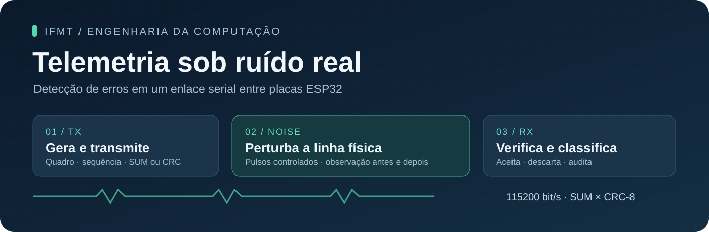
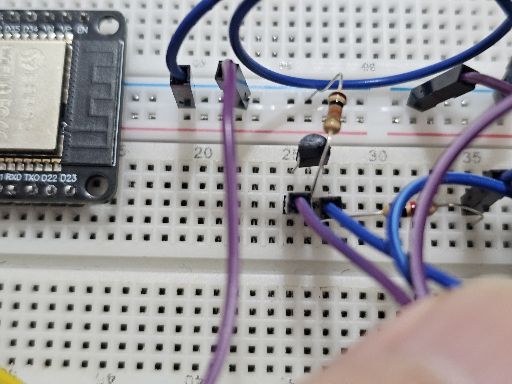

<p align="center">
  
</p>

<p align="center">
  <strong>Um enlace serial. Três ESP32. Duas formas de detectar erros.</strong><br>
  Projeto experimental de Transmissão e Comunicação de Dados · Engenharia da Computação · IFMT
</p>

<p align="center">
  <a href="#o-projeto">Projeto</a> ·
  <a href="#começar-em-poucos-passos">Começar</a> ·
  <a href="docs/protocolo.md">Protocolo</a> ·
  <a href="docs/montagem.md">Montagem</a> ·
  <a href="resultados/tabelas/README.md">Resultados</a> ·
  <a href="docs/coleta.md">Coleta de logs</a>
</p>

> **Estado dos experimentos:** coleta final em andamento. As tabelas serão preenchidas a partir de rodadas completas e válidas. Este repositório não apresenta resultados simulados como medições de bancada.

## O projeto

O transmissor monta quadros binários de telemetria. O receptor decide se os aceita usando **soma modular de 8 bits (SUM)** ou **CRC-8**, uma técnica por rodada. Uma terceira placa perturba fisicamente a linha, forçando determinados bits a zero por meio de um transistor.

Depois da decisão, uma cópia do payload original permite classificar cada envio e identificar o caso central do trabalho: **um quadro aceito com dados incorretos**.

| TX · transmissor | RX · receptor | NOISE · injetor |
|---|---|---|
| Gera dados e sequências | Sincroniza e executa a checagem | Detecta o início do quadro |
| Calcula SUM ou CRC-8 | Aceita ou descarta o quadro | Aplica o plano de ruído |
| Envia o quadro e a referência | Audita e classifica o resultado | Compara o sinal antes e depois |

## Começar em poucos passos

1. Abra os sketches em `firmware/tx/`, `firmware/rx/` e `firmware/noise/` na Arduino IDE e grave cada um na placa correspondente. [Configuração e conexões →](docs/montagem.md)
2. Conecte as três placas por USB ao mesmo computador e **feche os Monitores Seriais** da IDE.
3. No Windows, dê dois cliques em **[INICIAR_COLETA.bat](INICIAR_COLETA.bat)**. É necessário ter Python 3.10 ou superior; a dependência é instalada automaticamente na primeira abertura.
4. Selecione as portas de **TX, RX e NOISE**, a técnica, o modo e a semente. Comece com **SUM · modo 0 · 10 quadros**. Clique em **Iniciar coleta**.
5. Após validar a montagem, faça os sete ensaios oficiais de **1000 quadros**. A ferramenta salva os TXT, gera os CSVs e atualiza as tabelas.

O coletor identifica as placas, configura a rodada, inicia RX → NOISE → TX e envia `END` somente depois do `DONE` do transmissor. Você não precisa copiar milhares de linhas do Monitor Serial.

**Usar apenas a Arduino IDE também é possível.** Veja a ordem dos comandos e a organização de TXT já salvos em [Coleta de logs](docs/coleta.md).

## Protocolo em um quadro

`A5 5A 02 SEQ_H SEQ_L P0 P1 CHECK`

| Propriedade | Definição |
|---|---|
| Interface | UART · 115200 bit/s · 8N1 |
| Quadro | 8 bytes, com payload de 2 bytes |
| Campos protegidos | LEN + sequência + payload |
| SUM | Soma modular de 8 bits; CHECK fecha a soma em zero |
| CRC | CRC-8, polinômio `0x07`, inicial `0x00`, sem reflexão, XOR final `0x00` |
| Decisão | Resíduo zero: aceita; diferente de zero: descarta |
| Sequência | 16 bits, byte mais significativo primeiro |
| Período nominal | 50 ms; o intervalo efetivo é registrado |
| Overhead | 6 bytes por quadro, sem a cópia de depuração |

A referência `D3 91 SEQ_H SEQ_L 02 P0 P1` vem depois do quadro e de uma guarda de 2 ms. Ela é consultada **após a decisão**, exclusivamente para auditoria. [Especificação completa →](docs/protocolo.md)

## Experimentos

| Técnica | Condições oficiais | Quantidade |
|---|---|---:|
| SUM | Modos 0, 1, 2 e 3 | 1000 quadros por modo |
| CRC-8 | Modos 1, 2 e 3 | 1000 quadros por modo |

| Modo | Ruído planejado |
|---:|---|
| 0 | Desligado: linha de base |
| 1 | Um bit aleatório |
| 2 | Dois bits aleatórios distintos |
| 3 | Uma rajada de 3 a 8 bits contíguos dentro de um byte |

O transistor força **1 → 0**. Alvos que já estavam em zero não mudam. Os logs separam a máscara planejada das alterações efetivamente observadas.

### Classificação e taxa

| Classe | Significado |
|---|---|
| OK | Checagem aprovada e payload correto |
| CORROMPIDO | Checagem reprovada; quadro descartado |
| PERDIDO | Checagem não concluída |
| Não detectado | Checagem aprovada e payload incorreto |

As quatro contagens somam 1000 em uma rodada oficial. A taxa é `ND / (CORROMPIDO + ND) × 100`; denominador zero é **NA**.

**[Abrir as tabelas comparativas e os links para as evidências →](resultados/tabelas/README.md)**

## Logs que já saem organizados

Cada execução cria uma pasta própria dentro de `resultados/coletas/`, com data, técnica, modo e semente no nome:

| Arquivo | Conteúdo |
|---|---|
| `tx.txt`, `rx.txt`, `noise.txt` | Saída completa de cada placa, preservada como evidência |
| `tx.csv`, `rx.csv`, `noise.csv` | Dados separados dos avisos e mensagens de diagnóstico |
| `resumo.md` | Contagens, taxa, tempos, links e eventuais pendências |
| `tabela_professor.csv` | Uma linha no formato de resultados pedido pelo professor |
| `evidencias_nd.csv` | Quadros não detectados, com bytes e alterações observadas |
| `sessao.json`, `comandos.csv` | Configuração da coleta e comandos enviados |
| `resumo.json` | Resultado legível por outras ferramentas e hashes dos TXT |

Rodadas incompletas ou com falhas ficam preservadas e marcadas **REVISAR**. Somente coletas válidas de 1000 quadros entram nas tabelas finais. Ensaios de 10 quadros servem para conferir o funcionamento.

## Montagem

<p align="center">
  
</p>
<p align="center"><em>Detalhe do circuito injetor montado em protoboard. Acervo dos autores.</em></p>

[Foto da montagem completa](docs/fotos/montagem-geral.jpg) · [Esquema elétrico e lista de materiais](docs/montagem.md)

## Organização do repositório

| Pasta | O que contém |
|---|---|
| [`firmware/`](firmware/) | Sketches finais de TX, RX e NOISE v1.12; hashes de conferência |
| [`docs/`](docs/) | Protocolo, montagem, coleta, publicação e roteiro da demonstração |
| [`docs/relatorio/`](docs/relatorio/) | Local reservado para a versão revisada do relatório |
| [`resultados/coletas/`](resultados/coletas/) | Uma pasta por rodada, com os registros completos |
| [`resultados/tabelas/`](resultados/tabelas/) | Comparação SUM × CRC-8, gerada a partir das coletas válidas |
| [`ferramentas/`](ferramentas/) | Coletor gráfico e organizador de registros |
| [`tests/`](tests/) | Testes das ferramentas e da lógica do injetor no computador |

## Equipe

**Emily Weber de Arruda · Felipe Enzo Fukase · Kauan Santos Rondon**  
Engenharia da Computação — Instituto Federal de Mato Grosso, Cuiabá, 2026.  
Disciplina: Transmissão e Comunicação de Dados · Professor: Ruy Oliveira.

## Validação

```bash
python -m unittest discover -s tests -v
g++ -std=c++17 -O2 -Wall -Wextra tests/test_noise.cpp -o test_noise
./test_noise
```

Os testes verificam a lógica no computador. Compilação dos sketches, qualidade dos pulsos e resultados físicos devem ser confirmados nas placas. A base de firmware fornecida é a mesma do pacote NOISE v1.12; ela não foi modificada para organizar os logs.

## Documentação de apoio

- [Arduino-ESP32 — comunicação serial](https://docs.espressif.com/projects/arduino-esp32/en/latest/api/serial.html)
- [Espressif — ESP Timer](https://docs.espressif.com/projects/esp-idf/en/stable/esp32/api-reference/system/esp_timer.html)
- [CRC Catalogue — CRC-8/SMBUS](https://reveng.sourceforge.io/crc-catalogue/all.htm#crc.cat.crc-8-smbus)
- [pySerial — API](https://pyserial.readthedocs.io/en/latest/pyserial_api.html)

**Vai subir este pacote pela primeira vez?** Siga [Publicar no GitHub](docs/publicar-github.md).
