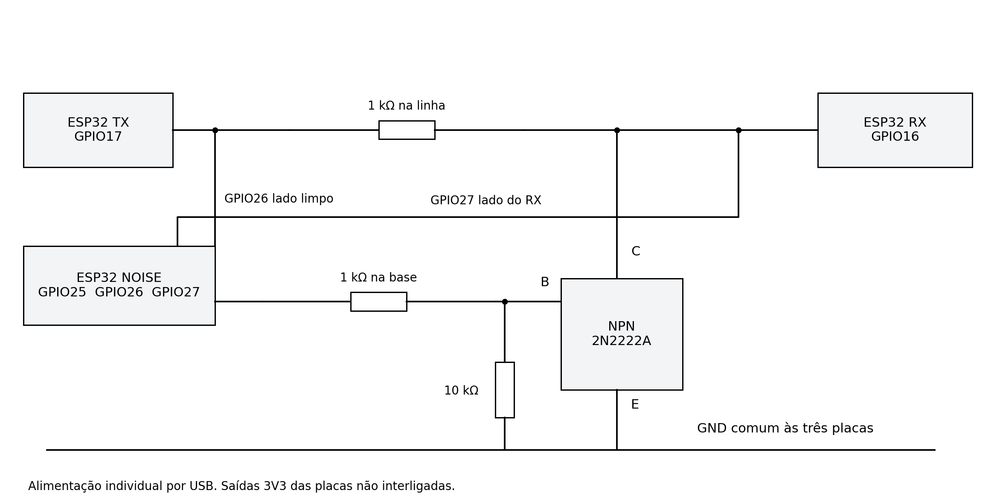
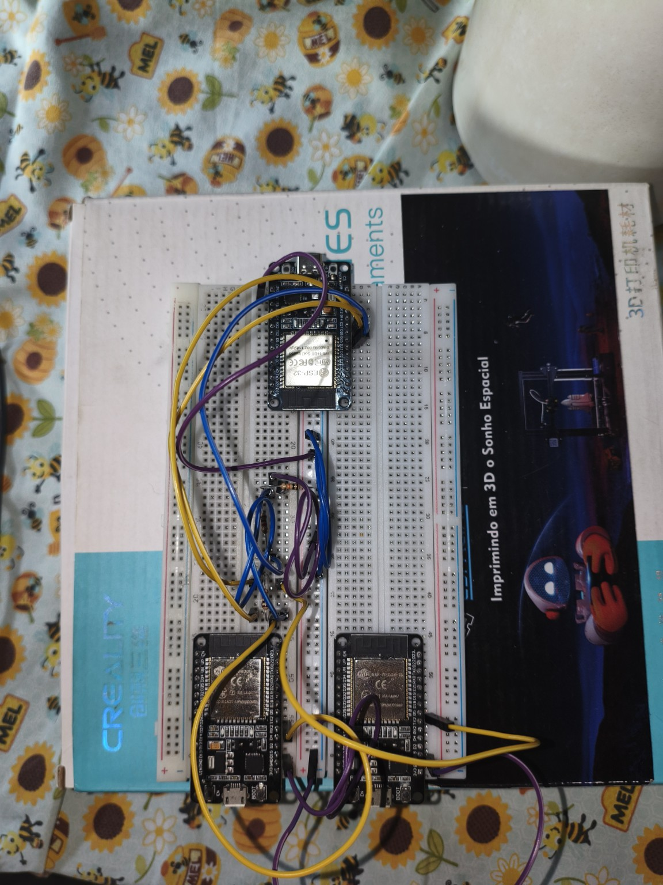

# Materiais e montagem

## Materiais

- Três ESP32 clássicos (ESP32-WROOM-32 / DevKit), com cabos USB.
- Protoboard e jumpers.
- Transistor NPN 2N2222A ou equivalente, com pinagem conferida para o componente utilizado.
- Dois resistores de 1 kΩ: um na linha serial e outro na base.
- Um resistor de 10 kΩ entre base e GND.

## Conexões utilizadas pelos firmwares

| Origem | Destino | Função |
|---|---|---|
| TX GPIO17 | Resistor de 1 kΩ → nó da linha perturbada | Telemetria |
| Nó da linha perturbada | RX GPIO16 e coletor do NPN | Entrada do RX e ponto de injeção |
| NOISE GPIO26 | TX GPIO17, antes do resistor da linha | Observação da linha original |
| NOISE GPIO27 | Nó da linha perturbada | Observação do que chega ao RX |
| NOISE GPIO25 | Resistor de 1 kΩ → base do NPN | Controle do transistor |
| Base do NPN | Resistor de 10 kΩ → GND | Mantém o transistor desligado em repouso |
| Emissor do NPN | GND comum | Caminho que puxa a linha para zero |
| GND das três placas | Mesmo GND | Referência elétrica comum |

Cada placa recebe alimentação pelo próprio USB. **Não interligue as saídas 3V3 das placas.** O NOISE apenas observa as duas linhas com suas UARTs de entrada; os pinos TX dessas UARTs ficam sem conexão. A comunicação de telemetria desta implementação vai do TX para o RX.

O transistor força nível baixo: um bit originalmente 1 pode virar 0; um bit que já era 0 permanece igual. Os GPIO26 e GPIO27 permitem distinguir o alvo planejado do efeito observado.

## Configuração na Arduino IDE

Abra separadamente `firmware/tx/tx.ino`, `firmware/rx/rx.ino` e `firmware/noise/noise.ino`. Cada sketch está numa pasta com o mesmo nome, como a IDE espera.

| Item | Configuração |
|---|---|
| Família da placa | ESP32 clássico, ESP32-WROOM-32 |
| Placa na IDE | ESP32 Dev Module, ou a correspondente ao DevKit clássico utilizado |
| Pacote alvo declarado nos códigos | esp32 by Espressif Systems, versão 3.3.12 |
| CPU do injetor | 240 MHz; APB de 80 MHz |
| Monitor Serial | 115200 baud, final de linha Nova linha ou Ambos NL e CR |

O firmware do injetor usa registradores e recursos do ESP32 clássico. Não foi preparado para ESP32-C3 ou ESP32-S3. Registre no relatório a versão do pacote efetivamente instalada. A indicação do código é uma configuração alvo, não prova de qual pacote foi utilizado em outra máquina.

## Fotos da bancada

### Detalhe do injetor

### Montagem geral

Acervo dos autores. Os arquivos foram mantidos como enviados. O esquema e a tabela de conexões complementam as fotos, cujos jumpers podem encobrir pinos e componentes.
